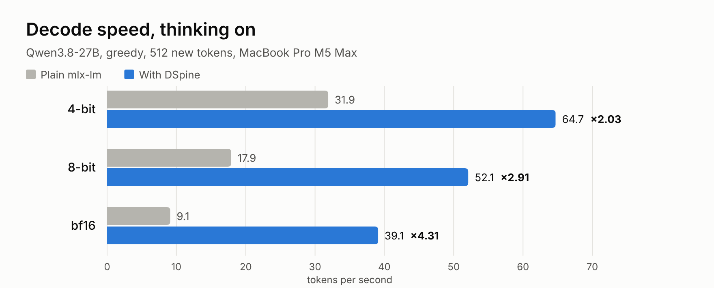
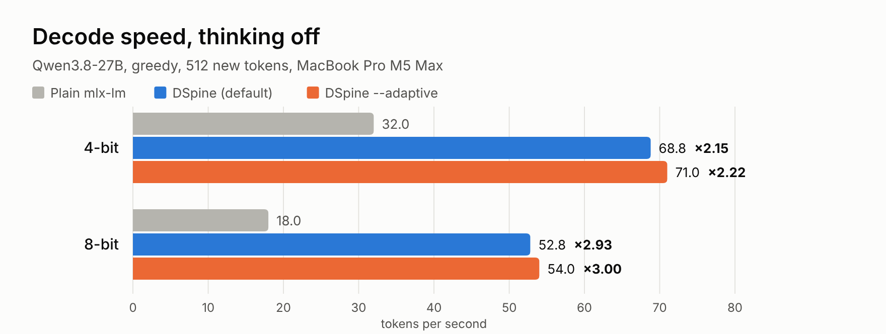
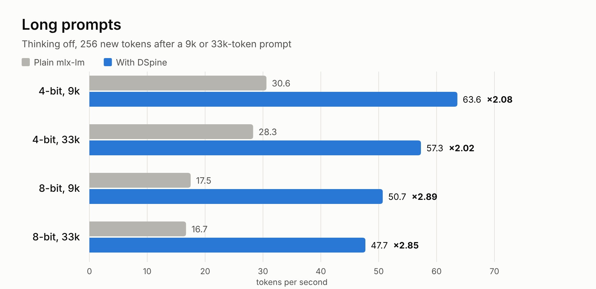

# dspine-hybrid-mlx

**DSpine speculative decoding for Qwen3.8-27B on Apple Silicon (MLX).**

[DSpine](https://github.com/Tencent/DSpine) is Tencent Hunyuan's parallel drafter: a small 5-layer draft model proposes a block of up to 16 tokens, and the target model checks the whole block in one pass. The output is the target's own output, only faster.

Tencent's MLX package (`dspine_mlx`) supports pure-attention targets such as Qwen3-8B. Qwen3.8-27B is a hybrid model, with 48 GatedDeltaNet (linear-attention) layers and 16 full-attention layers. Its recurrent state can't simply be cut back when part of a draft is rejected. This kit adds the two missing pieces, so [`tencent/Qwen3.8-27B-DSpine-b16`](https://huggingface.co/tencent/Qwen3.8-27B-DSpine-b16) runs on any MLX build of Qwen3.8-27B:

- **Exact rollback for GatedDeltaNet layers.** During verification the kit records each linear layer's inputs and starting state. When only part of the block is accepted, it replays the recurrence over the accepted tokens, so the state matches a plain decode of that prefix.
- **The draft's 8192-token sliding window**, which the checkpoint uses and `dspine_mlx` 0.1.0 rejects.

## Results (MacBook Pro M5 Max, 128 GB)

All speeds are greedy decoding, compared with plain mlx-lm on the same target. The output is the target's own (see below).

<picture>
  <source media="(prefers-color-scheme: dark)" srcset="assets/speed-dark.png">
  
</picture>

**Decode speed, thinking on.** 512 new tokens, 10 prompts (2 each from GSM8K, MATH-500, HumanEval, MBPP and MT-Bench), default settings (4-bit drafter):

| Target build | Plain mlx-lm | With DSpine | Speedup | Verify block |
|---|---|---|---|---|
| 4-bit (`mlx-community/Qwen3.8-27B-4bit`) | 31.9 tok/s | **64.7 tok/s** | **×2.03** | 5 |
| 8-bit (`mlx-community/Qwen3.8-27B-8bit`)¹ | 17.9 tok/s | **52.1 tok/s** | **×2.91** | 5 |
| bf16 | 9.1 tok/s | **39.1 tok/s** | **×4.31** | 16 |

¹ Measured on a local conversion with the same settings as `mlx-community/Qwen3.8-27B-8bit` (8-bit, group 64, affine), made with `mlx_lm.convert --hf-path Qwen/Qwen3.8-27B -q --q-bits 8 --q-group-size 64`.

<picture>
  <source media="(prefers-color-scheme: dark)" srcset="assets/thinking-off-dark.png">
  
</picture>

**Decode speed, thinking off.** Same prompts. `--adaptive` picks how many drafted tokens to check each round, which pays off when acceptance varies a lot, as it does with thinking off:

| Target build | Plain mlx-lm | DSpine (default) | DSpine `--adaptive` |
|---|---|---|---|
| 4-bit | 32.0 tok/s | **68.8 tok/s** (×2.15) | **71.0 tok/s** (×2.22) |
| 8-bit | 18.0 tok/s | **52.8 tok/s** (×2.93) | **54.0 tok/s** (×3.00) |

<picture>
  <source media="(prefers-color-scheme: dark)" srcset="assets/long-context-dark.png">
  
</picture>

**Long prompts.** A reference document of about 9k or 33k tokens, then a writing task. Thinking off, 256 new tokens, default settings:

| Target build | Prompt | Plain mlx-lm | With DSpine | Speedup |
|---|---|---|---|---|
| 4-bit | 9k tokens | 30.6 tok/s | **63.6 tok/s** | ×2.08 |
| 4-bit | 33k tokens | 28.3 tok/s | **57.3 tok/s** | ×2.02 |
| 8-bit | 9k tokens | 17.5 tok/s | **50.7 tok/s** | ×2.89 |
| 8-bit | 33k tokens | 16.7 tok/s | **47.7 tok/s** | ×2.85 |

Peak memory at 33k tokens: 29 GB (4-bit), 42 GB (8-bit).

**Why the block is 5 on quantized builds.** The drafter is trained to propose 16 tokens. On an Apple GPU, though, a quantized 27B forward pass costs about the same for 1 to 5 tokens and then steps up. On the 4-bit build that's 34 ms for 1 token, 42 ms for 5 and 89 ms for 16. Checking 5 tokens per round accepts fewer tokens than checking 16, but each round is much cheaper, so the net speed is higher. Use `--block-size` to choose a different block.

**Why a 4-bit drafter.** The drafter runs once per round, so making it smaller saves time on every round. A 4-bit drafter proposes almost the same tokens as the bf16 one (3.40 vs 3.35 accepted per round on the 4-bit target), and the target still checks every token. Use `--draft-bits 8`, or `--draft-bits 16` for the original bf16 drafter.

**Acceptance and quality (thinking off, bf16 drafter, full 16-token block).** These are not the conditions of the speed tables: short math answers reach about 7.2 tokens per round. Greedy, first 50 GSM8K test questions:

| Target build | Tokens per round | GSM8K accuracy |
|---|---|---|
| 4-bit | 7.25 | 90% |
| 8-bit | 7.32 | 84% |
| bf16 | 7.33 | 86% |
| Tencent's model card (GSM8K, T=0) | 7.20 | |

**Same output as plain decoding.** On a real model, logits from a 16-token verify pass differ slightly from one-token steps through rounding (99th percentile 1.2 on Qwen3.8-27B 4-bit). Every point where DSpine's greedy output departed from plain greedy was a near-tie of at most 0.25 logit, well inside that rounding. On small fp32 test models the outputs are token-identical.

## Install

Needs Python 3.11 or newer on Apple Silicon.

```bash
python3 -m venv .venv && source .venv/bin/activate
pip install "git+https://github.com/internet-projects/dspine-hybrid-mlx.git"
```

This installs `mlx-lm` 0.32.2 and Tencent's `dspine_mlx` at the tested commit (`0cc92d8`).

## Run

```bash
dspine-hybrid-generate \
  --target mlx-community/Qwen3.8-27B-4bit \
  --draft netprojects/Qwen3.8-27B-DSpine-b16-MLX \
  --prompt "Write a Python function that checks whether a number is prime." \
  --max-tokens 512 --baseline
```

`--baseline` also runs plain decoding and prints the speedup. The draft can also be given as `tencent/Qwen3.8-27B-DSpine-b16`; the files are the same. The verify block defaults to 5 on quantized targets and 16 on bf16, and the drafter is quantized to 4 bits when it loads. `--adaptive` chooses the verify length each round (greedy only; it measures this machine's target cost at startup, which takes a few seconds). `--thinking` turns on the chat template's thinking mode, `--temperature` enables sampling, and `--profile` prints a per-phase time split.

From Python:

```python
from dspine_hybrid.run import load

gen, target, _, _ = load("mlx-community/Qwen3.8-27B-4bit", "netprojects/Qwen3.8-27B-DSpine-b16-MLX")
tok = target.tokenizer
ids = tok.apply_chat_template([{"role": "user", "content": "Hello!"}],
                              add_generation_prompt=True, enable_thinking=False)
out, stats = gen.generate(ids, max_tokens=256)
print(tok.decode(out), stats.decode_tps, "tok/s")
```

`load(..., adaptive=True)` gives the adaptive generator, and `draft_bits=None` keeps the bf16 drafter. By default `load` caps MLX's buffer cache at 2 GB and sets a 60 GB memory limit. Override these with `DSPINE_CACHE_GB` and `DSPINE_MEMORY_LIMIT_GB`.

## Tests and benchmarks

```bash
pip install -e ".[bench]"
pytest -q                                   # 26 tiny-model tests
python scripts/bench_accept.py --help       # acceptance vs Tencent's card + output check
python scripts/speed.py --help              # plain vs DSpine decode speed
python scripts/quality.py --help            # GSM8K accuracy through DSpine
python scripts/noise_floor.py --help        # block-vs-single rounding on a real model
python scripts/block_sweep.py --help        # forward cost and DSpine speed per verify block
python scripts/profile_ab.py --help         # time split per round (draft / tail / verify / rollback)
python scripts/long_context.py --help       # speed with 9k / 33k-token prompts
```

## Notes

- Tested with mlx 0.32.4 and mlx-lm 0.32.2. `dspine_hybrid/hybrid_target.py` includes a copy of mlx-lm 0.32.2's GatedDeltaNet forward pass, plus recording. Other mlx-lm versions print a warning; run the tests before trusting them.
- Batch size 1 only, which is the same as `dspine_mlx`.
- Where the time goes, on the 4-bit build with block 16: target verify 88%, drafter 8%, the hybrid-state rollback under 1%.
- Long prompts: the prefill runs in 2048-token chunks and keeps logits only for the last position, and the drafter only reads the last 8192 positions, which is all its sliding window can see.
- Speeds come from the same machine, with no other jobs running. The bf16 row was measured with other local services paused; on bf16 the drafter is a small share of each round, so the 4-bit drafter makes little difference there (39.1 vs 39.3 tok/s with the bf16 drafter). The plain thinking-on baselines are from the v0.1 measurements; v0.2 does not change plain decoding.

## License and credits

Apache-2.0 (see `LICENSE` and `NOTICE`). Built on [Tencent DSpine](https://github.com/Tencent/DSpine) (Apache-2.0) and [mlx-lm](https://github.com/ml-explore/mlx-lm) (MIT). Not affiliated with Tencent, Alibaba/Qwen or Apple.

Made by [NetProjects](https://netprojects.com).
