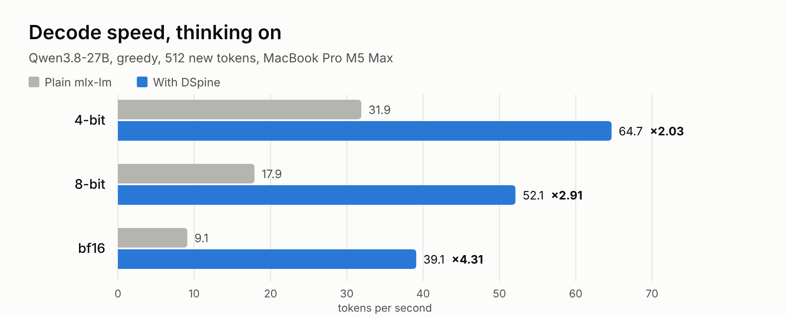
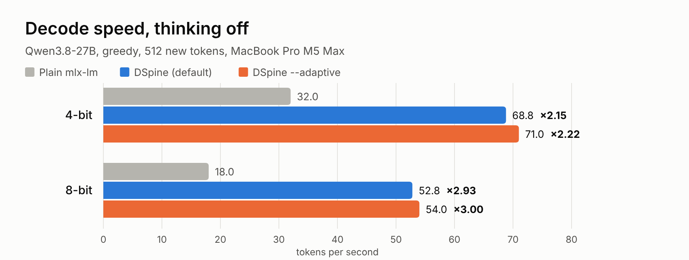
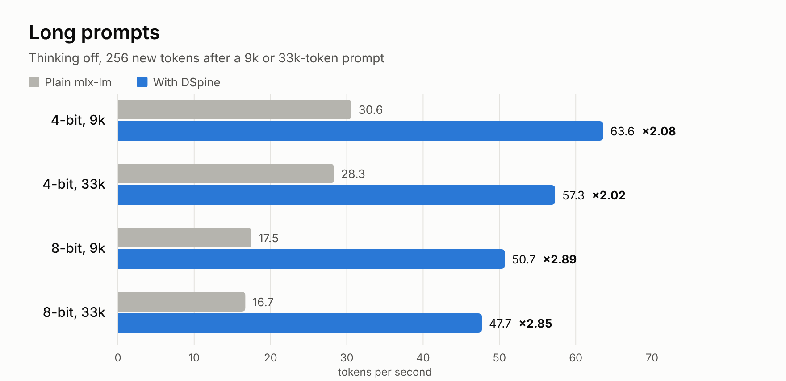

# dspine-hybrid-mlx

**DSpine speculative decoding for Qwen3.8-27B on Apple Silicon (MLX).**

**Now upstream:** Qwen3.8-27B support from this kit ([Tencent/DSpine#3](https://github.com/Tencent/DSpine/pull/3), merged 12 Nov 2026) and the prompt cache across turns with copy drafts ([Tencent/DSpine#21](https://github.com/Tencent/DSpine/pull/21), merged 25 Nov 2026) are in Tencent's official `dspine_mlx`. Use Tencent's package for the official route; this kit adds a local OpenAI-compatible server, `--adaptive` block sizing, a `--fast` mode for M5 Macs and a one-line install.

[DSpine](https://github.com/Tencent/DSpine) is Tencent Hunyuan's parallel drafter: a small 5-layer draft model proposes a block of up to 16 tokens, and the target model checks the whole block in one pass. The output is the target's own output, only faster.

Tencent's MLX package (`dspine_mlx`) 0.1.0 supported only pure-attention targets such as Qwen3-8B. Qwen3.8-27B is a hybrid model, with 48 GatedDeltaNet (linear-attention) layers and 16 full-attention layers. Its recurrent state can't simply be cut back when part of a draft is rejected. This kit adds the two missing pieces, so [`tencent/Qwen3.8-27B-DSpine-b16`](https://huggingface.co/tencent/Qwen3.8-27B-DSpine-b16) runs on any MLX build of Qwen3.8-27B:

- **Exact rollback for GatedDeltaNet layers.** During verification the kit records each linear layer's inputs and starting state. When only part of the block is accepted, it replays the recurrence over the accepted tokens, so the state matches a plain decode of that prefix.
- **The draft's 8192-token sliding window**, which the checkpoint uses and `dspine_mlx` 0.1.0 rejects.

## v0.4: a DSpine server for your Mac

v0.4 turns the kit into a small local engine built around DSpine: one command starts an OpenAI-compatible server, and editors, coding agents and chat apps use it through a base URL.

```bash
pip install "dspine-hybrid-mlx[fast] @ git+https://github.com/internet-projects/dspine-hybrid-mlx.git@v0.4.0"
dspine-hybrid-serve
```

With no arguments it loads `mlx-community/Qwen3.8-27B-4bit` and the DSpine drafter, turns fast mode on when the kernel wheel is installed, and prints the address to use (port 8791, or the next free one). Set the OpenAI base URL in your tool to `http://127.0.0.1:8791/v1`; any API key works.

Measured on a MacBook Pro M5 Max (128 GB) with our engine benchmark: the same 4-bit target, greedy, thinking off, both sides through their OpenAI-compatible servers, nothing else running:

| | Plain mlx-lm 0.32.2 | v0.4 `dspine-hybrid-serve` |
|---|---|---|
| Decode, code prompts | 31.2 tok/s | **186.4 tok/s** (×6.0) |
| Decode, prose prompts | 31.5 tok/s | **62.1 tok/s** (×2.0) |
| First token, 8K-token prompt | 10.3 s | **6.3 s** |
| First token, 32K-token prompt | 45.7 s | **28.7 s** |
| Decode right after a 32K prompt | 27.8 tok/s | **40.5 tok/s** |
| Five real tasks, total time¹ | 364 s | **181 s** |
| Peak memory | 32.9 GB | 32.4 GB |

¹ A chat, a two-turn agent task, a 32K-token document summary, a long code + prose answer, and a sampled chat with a long story (the follow-up turn of the agent task starts in 0.3 s on both, from the prompt cache).

**Several requests at once.** Up to 8 requests are decoded together (`--parallel`, default 8): every round checks all of them in one pass of the target, and each request gets the tokens it would get alone. A request that is alone runs on the faster one-request path and joins the shared rounds when another arrives. Total speed for 256-token answers:

| Requests at once | 1 | 2 | 4 | 8 |
|---|---|---|---|---|
| Code, total tok/s | 199 | 181 | 221 | 236 |
| Prose, total tok/s | 51 | 75 | 98 | 131 |

Finished conversations stay cached (up to `--cache-tokens`), so a follow-up turn, or a new conversation with the same system prompt and tool list, reads only its new messages. The target costs measured at the first start are kept for 14 days, so later starts are ready in about 2 seconds after the weights load.

The output is still the target's own: the target checks every drafted token. On long greedy outputs the text can differ from plain decoding at rounding ties, as it does between any two block sizes.

## Results of the one-request generator (MacBook Pro M5 Max, 128 GB)

All speeds are greedy decoding, compared with plain mlx-lm on the same target. The output is the target's own (see below).

<picture>
  <source media="(prefers-color-scheme: dark)" srcset="assets/speed-dark.png">
  
</picture>

**Decode speed, thinking on.** 512 new tokens, 10 prompts (2 each from GSM8K, MATH-500, HumanEval, MBPP and MT-Bench), default settings (4-bit drafter):

| Target build | Plain mlx-lm | With DSpine | Speedup | Verify block |
|---|---|---|---|---|
| 4-bit (`mlx-community/Qwen3.8-27B-4bit`) | 31.9 tok/s | **64.7 tok/s** | **×2.03** | 5 |
| 8-bit (`mlx-community/Qwen3.8-27B-8bit`)¹ | 17.9 tok/s | **52.1 tok/s** | **×2.91** | 5 |
| bf16 | 9.1 tok/s | **39.1 tok/s** | **×4.31** | 16 |

¹ Measured on a local conversion with the same settings as `mlx-community/Qwen3.8-27B-8bit` (8-bit, group 64, affine), made with `mlx_lm.convert --hf-path Qwen/Qwen3.8-27B -q --q-bits 8 --q-group-size 64`.

<picture>
  <source media="(prefers-color-scheme: dark)" srcset="assets/thinking-off-dark.png">
  
</picture>

**Decode speed, thinking off.** Same prompts. `--adaptive` picks how many drafted tokens to check each round, which pays off when acceptance varies a lot, as it does with thinking off:

| Target build | Plain mlx-lm | DSpine (default) | DSpine `--adaptive` |
|---|---|---|---|
| 4-bit | 32.0 tok/s | **68.8 tok/s** (×2.15) | **71.0 tok/s** (×2.22) |
| 8-bit | 18.0 tok/s | **52.8 tok/s** (×2.93) | **54.0 tok/s** (×3.00) |

<picture>
  <source media="(prefers-color-scheme: dark)" srcset="assets/long-context-dark.png">
  
</picture>

**Long prompts.** A reference document of about 9k or 33k tokens, then a writing task. Thinking off, 256 new tokens, default settings:

| Target build | Prompt | Plain mlx-lm | With DSpine | Speedup |
|---|---|---|---|---|
| 4-bit | 9k tokens | 30.6 tok/s | **63.6 tok/s** | ×2.08 |
| 4-bit | 33k tokens | 28.3 tok/s | **57.3 tok/s** | ×2.02 |
| 8-bit | 9k tokens | 17.5 tok/s | **50.7 tok/s** | ×2.89 |
| 8-bit | 33k tokens | 16.7 tok/s | **47.7 tok/s** | ×2.85 |

Peak memory at 33k tokens: 29 GB (4-bit), 42 GB (8-bit).

**Why the block is 5 on quantized builds.** The drafter is trained to propose 16 tokens. On an Apple GPU, though, a quantized 27B forward pass costs about the same for 1 to 5 tokens and then steps up. On the 4-bit build that's 34 ms for 1 token, 42 ms for 5 and 89 ms for 16. Checking 5 tokens per round accepts fewer tokens than checking 16, but each round is much cheaper, so the net speed is higher. Use `--block-size` to choose a different block.

**Why a 4-bit drafter.** The drafter runs once per round, so making it smaller saves time on every round. A 4-bit drafter proposes almost the same tokens as the bf16 one (3.40 vs 3.35 accepted per round on the 4-bit target), and the target still checks every token. Use `--draft-bits 8`, or `--draft-bits 16` for the original bf16 drafter.

**Acceptance and quality (thinking off, bf16 drafter, full 16-token block).** These are not the conditions of the speed tables: short math answers reach about 7.2 tokens per round. Greedy, first 50 GSM8K test questions:

| Target build | Tokens per round | GSM8K accuracy |
|---|---|---|
| 4-bit | 7.25 | 90% |
| 8-bit | 7.32 | 84% |
| bf16 | 7.33 | 86% |
| Tencent's model card (GSM8K, T=0) | 7.20 | |

**Same output as plain decoding.** On a real model, logits from a 16-token verify pass differ slightly from one-token steps through rounding (99th percentile 1.2 on Qwen3.8-27B 4-bit). Every point where DSpine's greedy output departed from plain greedy was a near-tie of at most 0.25 logit, well inside that rounding. On small fp32 test models the outputs are token-identical.

## Install

Needs Python 3.11 or newer on Apple Silicon.

```bash
python3 -m venv .venv && source .venv/bin/activate
pip install "git+https://github.com/internet-projects/dspine-hybrid-mlx.git"
```

This installs `mlx-lm` 0.32.2 and Tencent's `dspine_mlx` at the tested commit (`d211869`), which includes the hybrid support itself (merged in `c66bf44`). v0.2.0 and older pin `0cc92d8` and stop with a TypeError next to a newer `dspine_mlx`; v0.2.1 fixes that.

## Run

```bash
dspine-hybrid-generate \
  --target mlx-community/Qwen3.8-27B-4bit \
  --draft netprojects/Qwen3.8-27B-DSpine-b16-MLX \
  --prompt "Write a Python function that checks whether a number is prime." \
  --max-tokens 512 --baseline
```

`--baseline` also runs plain decoding and prints the speedup. The draft can also be given as `tencent/Qwen3.8-27B-DSpine-b16`; the files are the same. The verify block defaults to 5 on quantized targets and 16 on bf16, and the drafter is quantized to 4 bits when it loads. `--adaptive` chooses the verify length each round (greedy only; it measures this machine's target cost at startup, which takes a few seconds). `--thinking` turns on the chat template's thinking mode, `--temperature` enables sampling, and `--profile` prints a per-phase time split.

`--chat` starts a multi-turn chat. Each turn only prefills the new text: the target cache and the drafter's context are kept between turns (`--no-prompt-cache` turns that off). `--adaptive --confidence calibrated` sizes the verify step with Tencent's fitted acceptance maps for Qwen3.8-27B instead of the raw drafter probability, and then works with sampling (`--temperature`) too.

`--copy` proposes a context copy instead of running the drafter when the last 12 tokens (`--copy-min`) also occur earlier in the prompt or the answer, which is the common case when editing code or quoting text; it works with sampling too. `--tree` (greedy) spends the rows of a verify pass on the most likely nodes of the drafter's candidate table instead of on one chain, so a round can continue through a second choice. Both ideas come from TensorFold's DSpine lane. The output is unchanged either way: the target still decides every token. `scripts/bench_lanes.py` measures them against the default rounds.

### Fast mode (M5 and newer)

`--fast` turns on everything that measured faster on an M5 Max: `--adaptive --confidence calibrated`, `--tree`, `--fast-verify` and `--a8-prefill`. The last two use Metal kernels from [oMLX](https://github.com/jundot/omlx) (Apache-2.0). Without them the kit runs as before and prints `fast verify kernels: not available` and `int8 prefill: not available`.

- `--fast-verify` runs the wide check of a drafted block through oMLX's verify kernels, so checking 16 rows costs little more than checking 5. 
- `--a8-prefill` reads the prompt with 8-bit activations in the MLP and GatedDeltaNet projections. It changes the logits slightly (mean KL 0.002 against the stock prefill), so it is off unless asked for.

Install the kit with the `fast` extra and the kernels come prebuilt, so there is nothing to compile and no Xcode or Metal toolchain is needed:

```bash
pip install "dspine-hybrid-mlx[fast] @ git+https://github.com/internet-projects/dspine-hybrid-mlx.git"
dspine-hybrid-generate --fast --target mlx-community/Qwen3.8-27B-4bit \
  --draft netprojects/Qwen3.8-27B-DSpine-b16-MLX --prompt "Write a merge sort in Python."
```

The extra installs `dspine-omlx-kernels`, a 7 MB wheel from this repository's release page. It holds oMLX's unmodified Python package at commit `e1a402cf` with its kernel extensions built for Apple Silicon (macOS 15 or newer, Python 3.11 to 3.15, mlx 0.32.4), and none of oMLX's server dependencies. Don't install it next to oMLX itself: both provide the `omlx` package, and with oMLX installed (kernels built) the kit uses that instead. `packaging/build_kernel_wheel.py` builds the wheel from an oMLX checkout if you want to make your own.

Measured on the 4-bit target (MacBook Pro M5 Max, greedy, thinking off), installed from the prebuilt wheel. Decode is `scripts/speed.py` on the same 10 prompts as the tables above (512 new tokens); prefill is `scripts/bench_prefill.py`:

| | Plain mlx-lm | Default rounds | `--fast` |
|---|---|---|---|
| Decode, all 10 prompts | 31.8 tok/s | 71.0 tok/s (×2.23) | **108.6 tok/s** (×3.42) |
| Decode, code prompts (HumanEval, MBPP) | | | 177 to 284 tok/s |
| Decode, math prompts (GSM8K, MATH-500) | | | 124 to 154 tok/s |
| Decode, chat prompts (MT-Bench) | | | 50 to 81 tok/s |
| Tokens per round | | 3.55 | 5.48 |
| Prefill, 8k-token prompt | 898 tok/s | 898 tok/s | **1,295 tok/s** (×1.44) |
| Prefill, 32k-token prompt | 821 tok/s | 821 tok/s | **1,135 tok/s** (×1.38) |

Code is where the drafter is most often right, so it gains most; open-ended prose accepts fewer tokens per round. Peak memory is 21.9 GB with `--fast` against 20.4 GB. On long greedy outputs the text can differ from plain decoding at rounding ties (differences of at most 0.125 logit where the rounding noise is about 0.2), as it does between any two block sizes: 8 of the 10 prompts matched plain decoding token for token with `--fast`, 7 of 10 with the default rounds.

### Server

`dspine-hybrid-serve` is a local OpenAI-compatible server, so editors, coding agents and chat apps can use the kit by pointing at a base URL:

```bash
dspine-hybrid-serve                     # same as: --target mlx-community/Qwen3.8-27B-4bit \
                                        #   --draft netprojects/Qwen3.8-27B-DSpine-b16-MLX --parallel 8
```

```bash
curl http://127.0.0.1:8791/v1/chat/completions -H "Content-Type: application/json" \
  -d '{"messages": [{"role": "user", "content": "Write a merge sort in Python."}], "stream": true}'
```

Set the base URL to `http://127.0.0.1:8791/v1` in your tool; any model name and any API key are accepted. The HTTP side is mlx-lm's own server (chat templates, tool calls, reasoning output, streaming and token usage as in `mlx_lm.server`) with this kit's generator behind it. Thinking is off unless you pass `--thinking` or a request sets `chat_template_kwargs.enable_thinking`. Fast mode is on when the kernel wheel is installed (`--no-fast` turns it off).

Up to 8 requests are decoded together (`--parallel N` sets the number; `--parallel 1` decodes one at a time and queues the rest). A request that is alone uses the one-request generator with everything above (draft tree, calibrated adaptive block, fast checks); when a second request arrives it moves into the shared rounds without starting over, and the last one left moves back. `--no-alone` keeps every request in the shared rounds.

The prompt cache is kept between requests. Finished conversations stay cached up to `--cache-tokens` tokens (by default what the memory limit leaves; a 32K-token prompt holds about 11 GB), and the oldest are dropped first when a new prompt needs room. A follow-up turn of a conversation, or a new conversation with the same system prompt and tool list, reads only what is new.

At the first start the server measures what a target check costs on this Mac for 1 to 8 requests (a few seconds) and keeps the table for 14 days in `~/.cache/dspine-hybrid` (`DSPINE_CACHE_DIR` moves it, `--remeasure` measures again). Images, logprobs, logit bias and repetition, presence or frequency penalties are not supported.

From Python:

```python
from dspine_hybrid.run import load

gen, target, _, _ = load("mlx-community/Qwen3.8-27B-4bit", "netprojects/Qwen3.8-27B-DSpine-b16-MLX")
tok = target.tokenizer
ids = tok.apply_chat_template([{"role": "user", "content": "Hello!"}],
                              add_generation_prompt=True, enable_thinking=False)
out, stats = gen.generate(ids, max_tokens=256)
print(tok.decode(out), stats.decode_tps, "tok/s")
```

Send the whole conversation every turn, as above; `load` keeps the prompt cache on (`prompt_cache=False` turns it off), so a follow-up turn only prefills what is new, and `target.last_reused` says how many prompt tokens came from the cache. `load(..., adaptive=True)` gives the adaptive generator (`confidence="calibrated"` for the calibrated map), and `draft_bits=None` keeps the bf16 drafter. By default `load` caps MLX's buffer cache at 2 GB and sets a 60 GB memory limit. Override these with `DSPINE_CACHE_GB` and `DSPINE_MEMORY_LIMIT_GB`.

## Tests and benchmarks

```bash
pip install -e ".[bench]"
pytest -q                                   # tiny-model tests (the Metal-only ones are skipped off a Mac)
python scripts/bench_accept.py --help       # acceptance vs Tencent's card + output check
python scripts/speed.py --help              # plain vs DSpine decode speed
python scripts/quality.py --help            # GSM8K accuracy through DSpine
python scripts/noise_floor.py --help        # block-vs-single rounding on a real model
python scripts/block_sweep.py --help        # forward cost and DSpine speed per verify block
python scripts/profile_ab.py --help         # time split per round (draft / tail / verify / rollback)
python scripts/long_context.py --help       # speed with 9k / 33k-token prompts
```

## Notes

- Tested with mlx 0.32.4 and mlx-lm 0.32.2. `dspine_hybrid/hybrid_target.py` includes a copy of mlx-lm 0.32.2's GatedDeltaNet forward pass, plus recording. Other mlx-lm versions print a warning; run the tests before trusting them.
- `dspine-hybrid-generate` and `load()` decode one request at a time, as `dspine_mlx` does; the server decodes up to 8 together.
- Where the time goes, on the 4-bit build with block 16: target verify 88%, drafter 8%, the hybrid-state rollback under 1%.
- Long prompts: the prefill runs in 2048-token chunks and keeps logits only for the last position, and the drafter only reads the last 8192 positions, which is all its sliding window can see.
- Speeds come from the same machine, with no other jobs running. The bf16 row was measured with other local services paused; on bf16 the drafter is a small share of each round, so the 4-bit drafter makes little difference there (39.1 vs 39.3 tok/s with the bf16 drafter). The plain thinking-on baselines are from the v0.1 measurements; v0.2 does not change plain decoding.

## License and credits

Apache-2.0 (see `LICENSE` and `NOTICE`). Built on [Tencent DSpine](https://github.com/Tencent/DSpine) (Apache-2.0) and [mlx-lm](https://github.com/ml-explore/mlx-lm) (MIT). Not affiliated with Tencent, Alibaba/Qwen or Apple.

Made by [NetProjects](https://netprojects.com).
